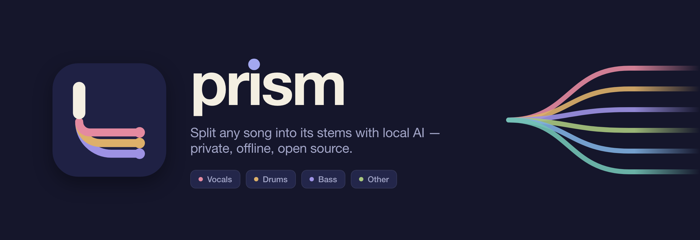
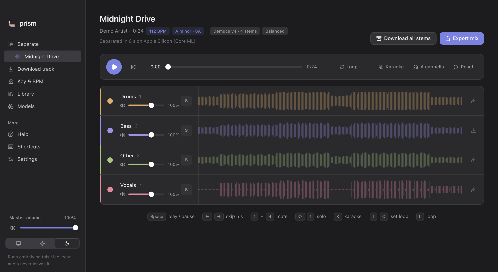
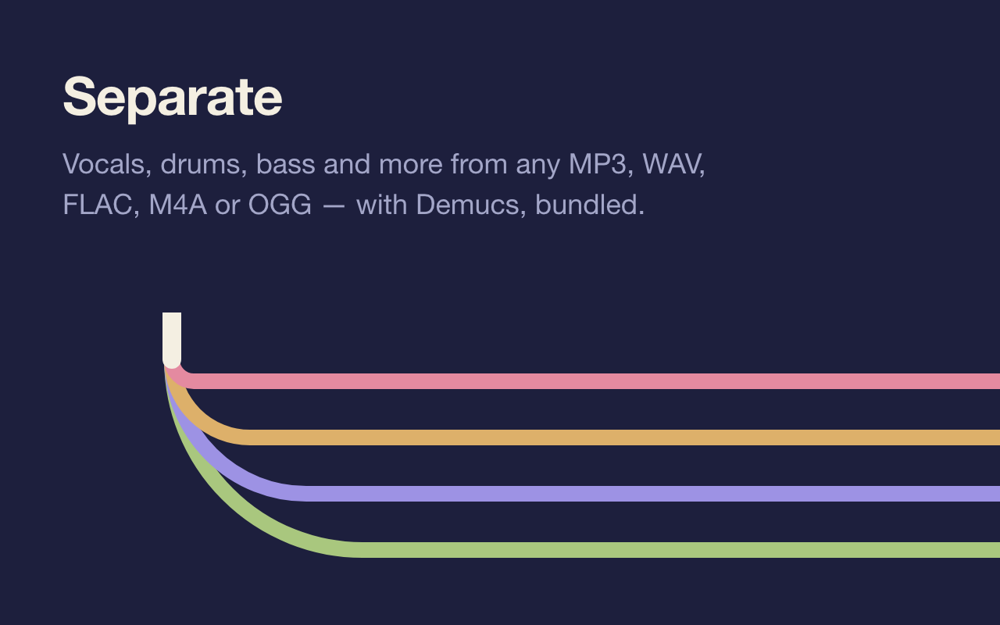
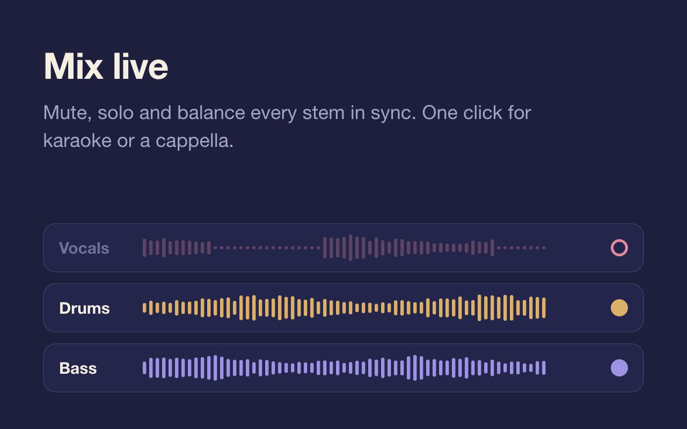
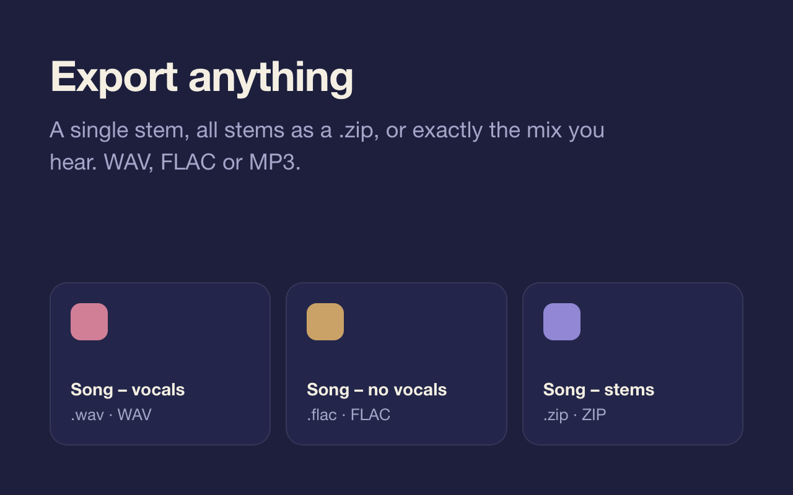
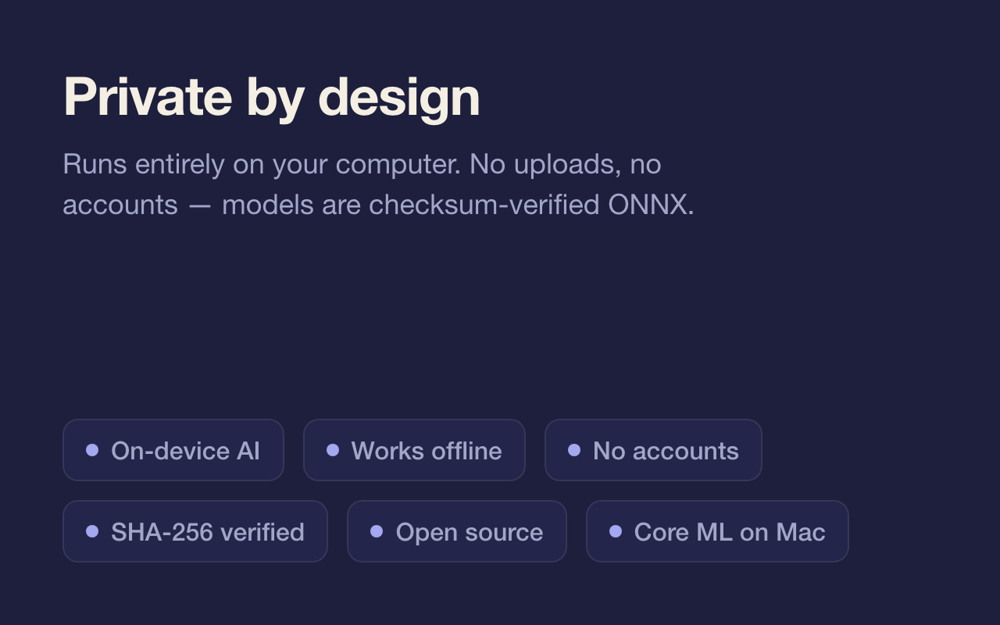
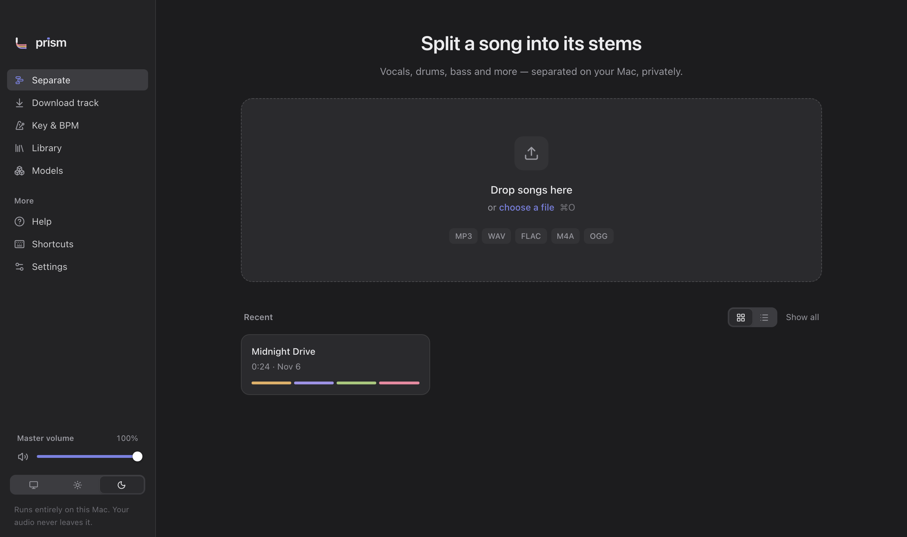
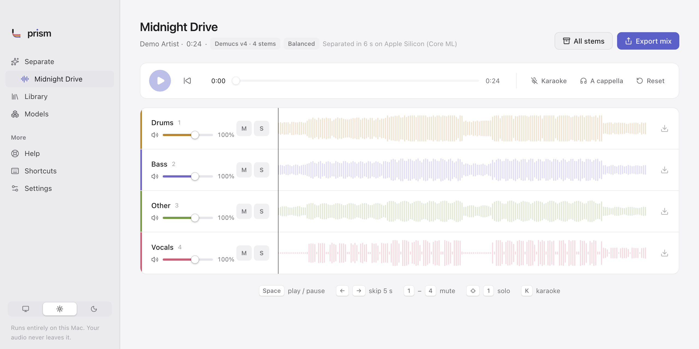
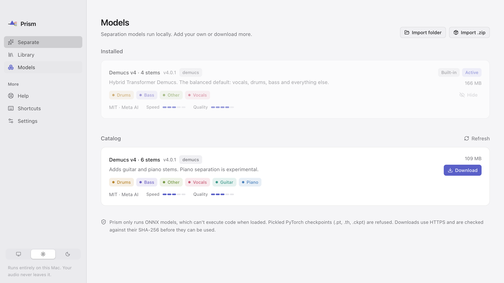
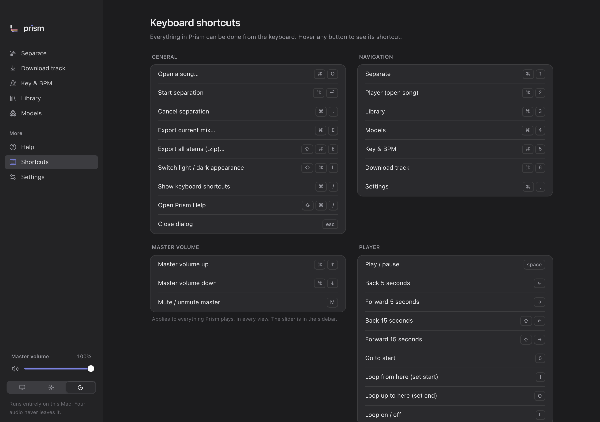

<div align="center">

<picture>
  <source media="(prefers-color-scheme: light)" srcset="docs/art/banner-light.png" />
  
</picture>

<br/><br/>

[](https://github.com/JonneNieminen/Prism/actions/workflows/build.yml)
[](https://github.com/JonneNieminen/Prism/releases/latest)
[](LICENSE)

<br/>


[](https://tauri.app)
[](https://www.rust-lang.org)
[](https://react.dev)
[](https://onnxruntime.ai)

A song goes in as white light and comes out as separate colored beams: vocals, drums, bass and more,<br/>
separated by a local AI model. Remove instruments, solo them, mix them, export them. Nothing leaves your computer.

<br/>



</div>

<br/>

<table>
  <tr>
    <td width="50%"><picture><source media="(prefers-color-scheme: light)" srcset="docs/art/card-separate-light.png" /></picture></td>
    <td width="50%"><picture><source media="(prefers-color-scheme: light)" srcset="docs/art/card-mix-light.png" /></picture></td>
  </tr>
  <tr>
    <td width="50%"><picture><source media="(prefers-color-scheme: light)" srcset="docs/art/card-export-light.png" /></picture></td>
    <td width="50%"><picture><source media="(prefers-color-scheme: light)" srcset="docs/art/card-private-light.png" /></picture></td>
  </tr>
</table>

## Features

- **Separate** MP3, WAV, FLAC, M4A (AAC/ALAC) and OGG into stems with Demucs v4 — bundled, works offline from the first launch.
- **Queue songs**: drop several at once, or drop more while one is separating; they run one after another and land in the Library.
- **Remove or isolate instruments** live: mute, solo and set the volume of each stem; one-click *Karaoke* and *A cappella*.
- **Synced multi-stem player** with a shared playhead, waveforms and full keyboard control.
- **Loop a part** to practice it: shift-drag across a waveform (or press **I** and **O**) and every stem loops in sync. Each song remembers its mix and loop.
- **Export** a single stem, all stems as a `.zip`, or exactly the mix you hear — WAV (24-bit), FLAC or MP3 (128–320 kbps).
- **Key and tempo detection**: every song gets an estimated BPM and musical key (with the Camelot code), shown in the player header and the library. Songs separated earlier get it when you open them.
- **Master volume**: one slider and a sound on/off switch in the sidebar, available in every view and remembered between launches.
- **Key & BPM**: a separate tool that finds a song's tempo and key (with Camelot code) in seconds, no separation needed.
- **Library** of past separations that reopen instantly, remembering which model made them.
- **Pluggable models**: import your own ONNX models, or download more from a checksum-verified catalog (6-stem Demucs, fine-tuned Demucs, MDX-Net vocal and instrumental models).
- **Fast on Apple Silicon** via Core ML — about 11× realtime on an M1 Pro — with automatic CPU fallback.
- **macOS, Windows and Linux** (x64 and ARM). Windows and Linux separate on the CPU.
- **Native feel**: light and dark appearance, a full menu bar, tooltips on every control, in-app Help and a Shortcuts reference.

<table>
  <tr>
    <td></td>
    <td></td>
  </tr>
  <tr>
    <td></td>
    <td></td>
  </tr>
</table>

## Install

Download the installer for your computer from [Releases](https://github.com/JonneNieminen/Prism/releases/latest):

| Platform | File |
|---|---|
| **macOS** (Apple silicon / Intel) | `Prism-x.y.z-osx-arm64.dmg` / `Prism-x.y.z-osx-x64.dmg` |
| **Windows** (x64 / ARM) | `Prism-x.y.z-win-x64-setup.exe` / `Prism-x.y.z-win-arm64-setup.exe` |
| **Linux** (x64 / ARM) | `Prism-x.y.z-linux-x64.AppImage` or `.deb` (`linux-arm64` too) |

- **macOS**: open the `.dmg` and drag Prism to Applications. The build isn't notarized yet, so run this once in Terminal (the DMG's *READ ME FIRST* explains it):
  ```bash
  xattr -dr com.apple.quarantine /Applications/Prism.app
  ```
- **Windows**: run the installer. SmartScreen may warn — choose *More info → Run anyway*.
- **Linux**: `chmod +x Prism-*.AppImage` and run it, or install the `.deb`.

## Using Prism

### 1. Separate a song

Drop a song onto the **Separate** screen, or press **⌘O** to choose one. Check the preview, pick a **model** and a **quality** and press **Separate** (**⌘↩**).

Drop several songs at once — or more songs while one is separating — and they wait under **Up next**. Each one starts by itself when the previous finishes, with the same model and quality, and you get a notification with an **Open** button as each is ready. Remove a song from the queue with its **×**; **Skip this song** (**⌘.**) moves on to the next.

| Quality | What it does | Speed (4-min song, M1 Pro) |
|---|---|---|
| **Fast** | One pass, less overlap between chunks | ≈ 20 s |
| **Balanced** | One shifted pass, standard overlap — the default | ≈ 25 s |
| **Best** | Averages three shifted passes for the cleanest stems | ≈ 70 s |

> The first separation with a model on Apple Silicon takes about a minute longer while macOS optimizes the model for your Mac. It's cached afterwards. You can keep using Prism while it runs, and cancel with **⌘.**.

### 2. Mix the stems

When separation finishes the player opens. Every stem plays in sync.

- Click a stem's name or its colored dot to mute it; **⇧-click** mutes or unmutes a whole range. **S** solos a stem — solo wins over mute, like a mixing desk.
- Drag a stem's slider to change its volume (up to 150%); double-click it to reset.
- **Karaoke** removes the vocals, **A cappella** keeps only the vocals, **Reset** turns everything back on.
- Click a waveform to jump there, or drag to scrub.
- **Loop a part**: hold **Shift** and drag across a waveform, or press **I** at the start and **O** at the end. **L** turns the loop on and off, and the **×** next to it clears it. All stems loop together, sample-accurately.
- Prism remembers each song's mix and loop, so it sounds the way you left it when you reopen it from the Library.

### 3. Export

- **Export mix** (**⌘E**) saves exactly what you hear as one file.
- **Download all stems** (**⇧⌘E**) saves a `.zip` with one file per stem.
- The download button on a stem saves just that stem.
- With a loop set, choose **Length → Loop** to export only that part (a practice section or a sample), with tiny fades so it never clicks.

Files are named like `Song Title - vocals.wav`. Choose a default save folder in **Settings**.

### Library, models and settings

- **Library** keeps your separations, so reopening a song is instant. To save disk space songs are deleted after 7 days by default — choose another period or *Never* in *Settings → Storage → Delete old songs*.
- **Models** lists installed models (stems, size, license, speed/quality) and a catalog of downloadable ones. Downloads use HTTPS and are SHA-256 verified before use. A model's license is shown before its first use, and non-commercial licenses are flagged.
- **Settings**: default model and quality, hardware acceleration, export format and bitrate, default save folder, appearance, storage and catalog URL.
- **Appearance**: match macOS, Light or Dark — from the sidebar, *View → Appearance*, Settings, or **⇧⌘L**.

## Keyboard shortcuts

Prism shows the shortcuts for your system: hover any button to see its shortcut, or open the in-app reference (**⌘/** on macOS, **Ctrl+/** on Windows and Linux). Below, **Mod** is **⌘** on macOS and **Ctrl** on Windows and Linux.

| Action | macOS | Windows / Linux |
|---|---|---|
| Open a song… | **⌘O** | **Ctrl+O** |
| Start separation | **⌘↩** | **Ctrl+Enter** |
| Cancel separation | **⌘.** | **Ctrl+.** |
| Export current mix… | **⌘E** | **Ctrl+E** |
| Export all stems (.zip)… | **⇧⌘E** | **Ctrl+Shift+E** |
| Switch light / dark | **⇧⌘L** | **Ctrl+Shift+L** |
| Keyboard shortcuts | **⌘/** | **Ctrl+/** |
| Prism Help | **⇧⌘/** | **Ctrl+Shift+/** |
| Close dialog | **Esc** | **Esc** |
| Separate · Player · Library · Models · Key & BPM | **⌘1** · **⌘2** · **⌘3** · **⌘4** · **⌘5** | **Ctrl+1** · **Ctrl+2** · **Ctrl+3** · **Ctrl+4** · **Ctrl+5** |
| Settings | **⌘,** | **Ctrl+,** |
| Master volume up / down | **⌘↑** / **⌘↓** | **Ctrl+↑** / **Ctrl+↓** |
| Mute / unmute master | **M** | **M** |

| Player | | Stems | |
|---|---|---|---|
| Play / pause | **Space** | Mute / unmute stem 1–9 | **1**–**9** |
| Back / forward 5 s | **←** / **→** | Solo stem 1–9 | **Shift+1**–**Shift+9** (**⇧1**–**⇧9** on macOS) |
| Back / forward 15 s | **Shift+←** / **Shift+→** | Karaoke (remove vocals) | **K** |
| Go to start | **0** | A cappella (vocals only) | **A** |
| Loop from here / up to here | **I** / **O** | Reset mix | **R** |
| Loop on / off | **L** | | |

| Window | macOS | Windows | Linux |
|---|---|---|---|
| Minimize | **⌘M** | system | system |
| Full screen | **⌃⌘F** | **F11** | **F11** |
| Hide Prism | **⌘H** | | |
| Quit | **⌘Q** | **Alt+F4** | **Ctrl+Q** |

## Build from source

Requirements: [Node](https://nodejs.org) 20+, [Rust](https://rustup.rs) (stable) and the [Tauri prerequisites](https://tauri.app/start/prerequisites/) for your OS (Xcode command line tools on macOS). On Intel Macs, also run `export ORT_DYLIB_PATH=$(build/fetch-onnxruntime-intel.sh)`.

```bash
git clone https://github.com/JonneNieminen/Prism.git && cd Prism
npm install
npm run fetch-models     # bundled Demucs weights (~174 MB), SHA-256 verified
npx tauri dev            # run the app
npx tauri build          # → target/release/bundle/{macos,dmg}
```

`npm run dev` runs only the UI in a browser with a mock backend — handy for UI work.

### Tests

```bash
cargo test --workspace                     # unit + end-to-end (decode → separate → export)
PRISM_TEST_AUDIO=~/Music/song.mp3 cargo test -p prism-core --test end_to_end
cargo clippy --workspace --all-targets -- -D warnings
npm run typecheck
npm test                                   # UI unit tests (Vitest)
```

CI ([`build.yml`](.github/workflows/build.yml)) runs all checks on every push and pull request and builds the `.dmg` as a downloadable artifact.

## Architecture

```
React UI (src/) ──typed IPC──▶ Tauri commands (src-tauri/) ──▶ prism-core (crates/prism-core/)
  Web Audio player                 background jobs, menu, events     decode → Separator → library → export
                                                                     ONNX Runtime (Core ML / CPU) + Rust STFT
```

Inference is **ONNX Runtime in Rust** — no Python at runtime. Demucs' STFT/iSTFT don't export cleanly to ONNX, so the graph takes and returns spectrograms and Prism does the STFT, chunking, overlap-add and time-shift averaging in Rust. The output matches stock PyTorch Demucs to float precision (82–95 dB SNR on real music); the MDX-Net adapter matches the Ultimate Vocal Remover algorithm at 126 dB.

| Path | What's there |
|---|---|
| `crates/prism-core` | Audio decoding, STFT, `Separator` trait, model adapters, manifest validation, model store, catalog, library, export |
| `crates/prism-cli` | Headless `prism separate / compare / validate` for benchmarks and parity checks |
| `src-tauri` | Tauri commands, background jobs, native menu |
| `src` | React UI — `lib/ipc.ts` is the only backend boundary |
| `models/` · `catalog/` | Bundled model manifest · default model catalog |
| `tools/export` | Dev-only, pinned Python env that converts Demucs to ONNX and verifies parity |

## Adding your own model

A model is a folder with a `model.json` and ONNX weights. Prism only runs **ONNX** — PyTorch checkpoints (`.pt`, `.th`, `.ckpt`) are refused because they can execute code when loaded.

```jsonc
{
  "schemaVersion": 1,
  "id": "my-vocals",                 // a–z 0–9 . _ -, unique
  "name": "My vocal model",
  "architecture": "mdx-net",         // which adapter runs it: "demucs" or "mdx-net"
  "weights": "model.onnx",           // or a list: [{ "file", "sha256", "stemWeights" }]
  "sha256": "…64 hex…",              // optional for imports, required in catalogs
  "sampleRate": 44100,
  "channels": 2,
  "stems": [                         // in the model's output order
    { "id": "vocals", "label": "Vocals" },
    { "id": "instrumental", "label": "Instrumental", "color": "#7EAEDF", "source": "residual" }
  ],
  "chunkSeconds": 5.92,
  "overlap": 0.5,
  "license": "MIT",                  // non-commercial licenses (e.g. CC-BY-NC) are flagged
  "author": "You",
  "description": "Clean vocals",
  "hints": { "speed": 4, "quality": 4 },            // 1–5, shown in the model picker
  "quality": { "fast": { "overlap": 0.25 }, "balanced": { "overlap": 0.5 }, "best": { "overlap": 0.75 } },
  "params": { "nFft": 7680, "hop": 1024, "dimF": 3072, "dimT": 256, "compensate": 1.021 }
}
```

- **Stems** drive the UI: cards, colors and export names. `vocals`, `drums`, `bass`, `guitar`, `piano` and `other` use Prism's palette; others use `color` or a generated one. A `"source": "residual"` stem is computed as *mix − the model's other stems*.
- **Import** it in *Models → Import folder / Import .zip*. Prism validates the manifest, checks the checksum and copies only `model.json`, the weights and a LICENSE/README.

| `architecture` | Typical models | `params` |
|---|---|---|
| `demucs` | htdemucs, htdemucs_6s, htdemucs_ft (exported with `tools/export`) | `segmentSamples`, `nfft`, `hop` |
| `mdx-net` | UVR MDX-Net ONNX models (`[1, 4, dimF, dimT]`) | `nFft`, `hop`, `dimF`, `dimT`, `compensate`, `denoise` |

**New architectures** (e.g. BS-RoFormer, Mel-Band RoFormer): add `crates/prism-core/src/adapters/<name>.rs` implementing `Separator` (reuse `dsp::Stft` and `runtime::session`), register it in `adapters/mod.rs`, and add a parity test against the reference implementation. Nothing else in the app changes.

## Privacy & security

- No network access except the model catalog when you open it. No accounts, no telemetry.
- Stems and settings live in `~/Library/Application Support/com.jonnenieminen.prism`; compiled Core ML models in `~/Library/Caches/com.jonnenieminen.prism`. Both can be cleared in Settings.
- Model packages are never executed; only `.onnx` weights are loaded, and downloads are SHA-256 verified before they're usable.

## Contributing

Issues and pull requests are welcome — see [CONTRIBUTING.md](CONTRIBUTING.md).

## License

Prism is [MIT](LICENSE) licensed. Demucs (code and weights) is MIT, © Meta Platforms. UVR MDX-Net models come from the [Ultimate Vocal Remover](https://github.com/Anjok07/ultimatevocalremovergui) project (MIT).
